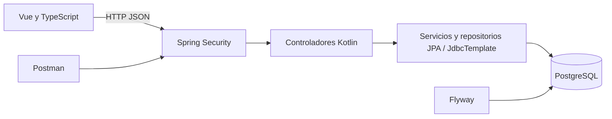

# Documentación técnica del código — Diplomatic Fleet V10

## Arquitectura y responsabilidades

La interfaz Vue 3, escrita en TypeScript, se comunica mediante HTTP con Spring Boot. El proxy de Vite reenvía las rutas `/api` a `localhost:8080`. Kotlin utiliza Spring MVC, Jakarta Validation, Spring Security, JPA/Hibernate para entidades de los módulos históricos y JdbcTemplate para operaciones transaccionales que requieren consultas SQL y bloqueos explícitos. PostgreSQL conserva relaciones, restricciones y datos; Flyway valida y aplica migraciones. Gradle configura dependencias y compilación. No se incorporaron dependencias externas nuevas en V10.

## Módulos y contratos

| Paquete o archivo | Responsabilidad técnica |
|---|---|
| DiplomaticFleetApplication.kt | Inicializa el contexto Spring Boot y el servidor HTTP. |
| config/SecurityConfig.kt | Configura BCrypt, HTTP Basic y permisos de rutas por rol. |
| seguridad/UsuarioAuth.kt | Carga autoridades activas, devuelve Perfil, registra cliente y realiza alta administrativa inicial por entorno. |
| clientes/controller, service, repository, domain, dto | Consulta, alta, edición y activación lógica de instituciones con ciudad y dirección. |
| flota/controller, service, repository, domain, dto | Gestiona categorías, fichas vehiculares, documentos y mantenimientos; las entidades representan tablas existentes. |
| catalogo/controller, service, repository, domain, dto | Catálogo e intereses comerciales de la versión histórica; distingue contacto preliminar de reserva. |
| reservas/ReservaController.kt | Proyección pública, cálculo de tarifas, consultas institucionales, transiciones, pagos, cancelaciones y control de solapamientos. |
| operaciones/OperacionAdminController.kt | Registro y cambios de estado de documentos, mantenimiento, conductores institucionales, cotizaciones, usuarios y reportes. |
| operaciones/AccesoYAsignacionesController.kt | Alta de cuentas por rol, consulta/asignación profesional, agenda privada, aceptación de cotización y auditoría técnica. |
| exception/GlobalExceptionHandler.kt | Convierte errores controlados a HTTP 400, 404 y 409 con formato uniforme. Spring Security deniega acceso no autorizado. |
| frontend/src/services | Define los contratos de intercambio, centraliza HTTP Basic, las rutas y las conversiones de fecha y moneda. |
| frontend/src/router/index.ts | Dirige las vistas según perfil, sin reemplazar la autorización del servidor. |
| frontend/src/components/layout | Navegación pública y lateral, composición visual del panel; oculta rutas incompatibles con el perfil. |
| frontend/src/components/login | Formulario original de acceso, panel visual y documentos legales informativos. |
| frontend/src/views | Vistas funcionales de login, catálogo, registro, reservas, cotizaciones, agenda, administración y auditoría. |
| frontend/src/assets/styles/fleet.css | Diseño de interfaz y animaciones globales: transiciones, tarjetas, foco y movimiento reducido. |
| frontend/src/assets/styles/login.css | Estética del acceso original, conservada. |
| frontend/public/assets/images | Recursos gráficos locales de demostración. |
| src/main/resources/static/index.html | Información de la API local y enlace a Vue; no simula autenticación. |
| scripts/CREAR_CUENTAS_DEMO_V10.ps1 | Crea cinco cuentas adicionales a través de HTTP, evitando duplicados; genera claves distintas. |
| postman/*.json | Peticiones documentadas, autenticación por variables y aserciones HTTP. |

## API de V10 y respuestas

El cuerpo JSON corresponde a los DTO de Kotlin y las interfaces de TypeScript. Se exige autenticación Basic para rutas privadas. `401` indica credenciales inválidas; `403` acceso denegado; `404` recurso no visible o inexistente; `409` conflicto de regla de negocio; `400` validación. Los endpoints de escritura deben ejecutarse con datos de prueba.

| Método y ruta | Rol | Función |
|---|---|---|
| GET /api/public/vehiculos | Público | Disponibilidad por inicio/fin; retorna fichas sin placa. |
| GET /api/auth/me | Autenticado | Perfil actual sin contraseña ni hash. |
| POST /api/auth/registro | Público | Crea institución y cuenta CLIENTE. |
| GET/POST/PUT /api/clientes... | Administrador | Gestión institucional. |
| GET/POST/PUT /api/vehiculos... | Administrador, Operaciones | Gestión de vehículos. |
| GET /api/solicitudes/mias | Cliente | Solicitudes de su institución. |
| POST /api/solicitudes | Cliente | Alta de reserva con modalidad y método de pago. |
| PATCH /api/solicitudes/{id}/periodo | Cliente propietario | Reprograma fechas pendientes y recalcula el importe bajo bloqueo de la unidad. |
| POST /api/solicitudes/{id}/cancelar | Cliente o administrador | Cancela con motivo, verifica propiedad y transición. |
| POST /api/solicitudes/{id}/pago/reportar | Cliente | Referencia de transferencia externa. |
| GET /api/admin/solicitudes | Administrador | Bandeja completa. |
| PATCH /api/admin/solicitudes/{id}/estado | Administrador | Revisión, confirmación, inicio o finalización. |
| POST /api/admin/solicitudes/{id}/pago/inicializar | Administrador | Medio de pago faltante de una reserva anterior a V9. |
| PATCH /api/admin/solicitudes/{id}/pago | Administrador | Revisión del pago/reembolso manual. |
| GET/POST /api/admin/documentos; PUT /api/admin/documentos/{id} | Administrador, Operaciones | Control documental. |
| GET/POST /api/admin/mantenimientos; PATCH /api/admin/mantenimientos/{id}/estado | Administrador, Operaciones | Programación y estados de mantenimiento. |
| GET/POST /api/admin/conductores; PATCH /api/admin/conductores/{id}/activo | Administrador | Conductores institucionales. |
| GET/POST /api/admin/cotizaciones; PATCH /api/admin/cotizaciones/{id}/estado | Administrador | Versiones económicas, publicar y anular. |
| GET /api/cliente/cotizaciones; PATCH /api/cliente/cotizaciones/{id}/estado | Cliente | Propuestas propias y decisión comercial. |
| GET/POST /api/admin/usuarios; PATCH /api/admin/usuarios/{id}/activo | Administrador | Consultas, altas y suspensión lógica. |
| GET /api/admin/conductores-profesionales | Administrador | Personal asignable y vigencia declarada. |
| PATCH /api/admin/solicitudes/{id}/conductor | Administrador | Asignación profesional. |
| GET /api/conductor/asignaciones | Conductor | Agenda propia. |
| GET /api/admin/reportes | Administrador | Indicadores agregados de la base. |
| GET /api/admin/auditoria | Administrador | Últimos 500 cambios técnicos desde V10. |

## Persistencia

Las migraciones V1–V9 son archivos históricos aplicados y conservados byte a byte. V10 añade el rol CONDUCTOR, `conductores_profesionales`, el vínculo profesional y justificación/usuario de inicio en `solicitudes`, decisión de cotización, flota ficticia y `auditoria_operativa`. Amplía la restricción de modalidad para permitir solicitudes aún no asignadas. No elimina datos. El historial se activa después de insertar los vehículos de demostración; por ello no presenta esas inserciones iniciales como eventos de usuario. Las claves foráneas mantienen la integridad. No se escribe información sensible en los eventos de auditoría.

## Seguridad y límites del entorno académico

BCrypt almacena hashes con sal; las contraseñas de demostración se generan en el equipo del usuario. HTTP Basic y `sessionStorage` se mantienen por compatibilidad con la V9 y Postman, exclusivamente para uso local; para producción se requiere HTTPS, autenticación más robusta, protección de sesión, endurecimiento de autorización, políticas de secretos y pruebas especializadas. El cliente no puede elegir su rol privilegiado. Las rutas privadas se autorizan en Spring Security y las consultas de cotizaciones y reservas filtran por institución. Las credenciales nunca deben incluirse en el control de versiones.

## Convenciones de documentación interna

Se preservaron los comentarios existentes; se añadieron KDoc y comentarios de propósito a clases, servicios, funciones de autenticación y operaciones V10, comentarios en las consultas/migraciones y JSDoc en servicios Vue. La documentación describe invariantes, entradas, efectos y límites. Las clases/funciones históricas no modificadas conservan sus comentarios; no se añadieron comentarios triviales a cada instrucción. El profesor puede consultar el inventario de archivos y los contratos de este documento para complementar la lectura del código.

## Inventario de código fuente

Los nombres de declaraciones se extrajeron de los archivos entregados.

| Archivo Kotlin (ruta relativa al paquete backend) | Declaraciones principales |
|---|---|
| `DiplomaticFleetApplication.kt` | `DiplomaticFleetApplication`, `main` |
| `catalogo/controller/CatalogoController.kt` | `CatalogoController`, `listar`, `detalle` |
| `catalogo/controller/SolicitudCatalogoController.kt` | `SolicitudCatalogoController`, `solicitar`, `SolicitudCatalogoAdminController`, `listar`, `cambiarEstado` |
| `catalogo/domain/SolicitudCatalogo.kt` | `SolicitudCatalogo`, `EstadoSolicitudCatalogo` |
| `catalogo/dto/CatalogoVehiculoResponse.kt` | `CatalogoVehiculoResponse` |
| `catalogo/dto/SolicitudCatalogoDto.kt` | `SolicitudCatalogoRequest`, `SolicitudCreadaResponse`, `SolicitudCatalogoAdminResponse`, `CambiarEstadoSolicitudRequest` |
| `catalogo/repository/SolicitudCatalogoRepository.kt` | `SolicitudCatalogoRepository`, `findAllByOrderByCreadoEnDesc` |
| `catalogo/service/CatalogoVehiculoService.kt` | `CatalogoVehiculoService`, `listar`, `detalle`, `buscarVisible`, `convertir` |
| `catalogo/service/SolicitudCatalogoService.kt` | `SolicitudCatalogoService`, `registrar`, `listar`, `actualizarEstado`, `convertir` |
| `clientes/controller/ClienteInstitucionalController.kt` | `ClienteInstitucionalController`, `registrar`, `listar`, `obtenerPorId`, `actualizar` |
| `clientes/domain/ClienteInstitucional.kt` | `ClienteInstitucional` |
| `clientes/domain/TipoEntidad.kt` | `TipoEntidad` |
| `clientes/dto/ClienteInstitucionalRequest.kt` | `ClienteInstitucionalRequest` |
| `clientes/dto/ClienteInstitucionalResponse.kt` | `ClienteInstitucionalResponse` |
| `clientes/repository/ClienteInstitucionalRepository.kt` | `ClienteInstitucionalRepository`, `findByNombreEntidadIgnoreCase`, `existsByNombreEntidadIgnoreCase`, `findByCorreoContactoIgnoreCase`, `existsByCorreoContactoIgnoreCase`, `findByNumeroIdentificacionFiscal`, `existsByNumeroIdentificacionFiscal`, `findAllByActivoOrderByNombreEntidadAsc`, `findAllByTipoEntidadOrderByNombreEntidadAsc` |
| `clientes/service/ClienteInstitucionalService.kt` | `ClienteInstitucionalService`, `registrar`, `listar`, `obtenerPorId`, `actualizar`, `validarDatosUnicos`, `buscarEntidadPorId`, `normalizarTextoOpcional`, `convertirAResponse` |
| `config/SecurityConfig.kt` | `SecurityConfig`, `passwordEncoder`, `securityFilterChain` |
| `exception/ConflictoException.kt` | `ConflictoException` |
| `exception/GlobalExceptionHandler.kt` | `ErrorResponse`, `GlobalExceptionHandler`, `malformed`, `databaseConstraint`, `manejarRecursoNoEncontrado`, `manejarConflicto`, `manejarValidacion`, `construirRespuesta` |
| `exception/RecursoNoEncontradoException.kt` | `RecursoNoEncontradoException` |
| `flota/controller/VehiculoController.kt` | `VehiculoController`, `registrar`, `listar`, `obtenerPorId`, `actualizar` |
| `flota/domain/CategoriaVehiculo.kt` | `CategoriaVehiculo` |
| `flota/domain/CodigoCategoriaVehiculo.kt` | `CodigoCategoriaVehiculo` |
| `flota/domain/DocumentoVehiculo.kt` | `DocumentoVehiculo` |
| `flota/domain/EstadoDocumentoVehiculo.kt` | `EstadoDocumentoVehiculo` |
| `flota/domain/EstadoMantenimiento.kt` | `EstadoMantenimiento` |
| `flota/domain/EstadoVehiculo.kt` | `EstadoVehiculo` |
| `flota/domain/Mantenimiento.kt` | `Mantenimiento` |
| `flota/domain/TipoCombustible.kt` | `TipoCombustible` |
| `flota/domain/TipoDocumentoVehiculo.kt` | `TipoDocumentoVehiculo` |
| `flota/domain/TipoMantenimiento.kt` | `TipoMantenimiento` |
| `flota/domain/Vehiculo.kt` | `Vehiculo` |
| `flota/dto/CategoriaVehiculoRequest.kt` | `CategoriaVehiculoRequest` |
| `flota/dto/CategoriaVehiculoResponse.kt` | `CategoriaVehiculoResponse` |
| `flota/dto/DocumentoVehiculoRequest.kt` | `DocumentoVehiculoRequest` |
| `flota/dto/DocumentoVehiculoResponse.kt` | `DocumentoVehiculoResponse` |
| `flota/dto/MantenimientoRequest.kt` | `MantenimientoRequest` |
| `flota/dto/MantenimientoResponse.kt` | `MantenimientoResponse` |
| `flota/dto/VehiculoRequest.kt` | `VehiculoRequest` |
| `flota/dto/VehiculoResponse.kt` | `VehiculoResponse` |
| `flota/repository/CategoriaVehiculoRepository.kt` | `CategoriaVehiculoRepository`, `findByCodigo`, `findAllByActivoOrderByNombreAsc`, `existsByCodigo` |
| `flota/repository/DocumentoVehiculoRepository.kt` | `DocumentoVehiculoRepository`, `findAllByVehiculoIdOrderByFechaVencimientoAsc`, `findAllByVehiculoIdAndTipoDocumentoOrderByFechaVencimientoDesc`, `findAllByEstadoOrderByFechaVencimientoAsc`, `findAllByFechaVencimientoBetweenOrderByFechaVencimientoAsc`, `existsByVehiculoIdAndTipoDocumento` |
| `flota/repository/MantenimientoRepository.kt` | `MantenimientoRepository`, `findAllByVehiculoIdOrderByFechaProgramadaDesc`, `findAllByTipoOrderByFechaProgramadaDesc`, `findAllByEstadoOrderByFechaProgramadaAsc`, `findAllByFechaProgramadaBetweenOrderByFechaProgramadaAsc`, `existsByVehiculoId` |
| `flota/repository/VehiculoRepository.kt` | `VehiculoRepository`, `findByPlacaIgnoreCase`, `existsByPlacaIgnoreCase`, `findAllByEstadoAndActivoOrderByMarcaAscModeloAsc`, `findAllByCategoriaIdAndActivoOrderByMarcaAscModeloAsc`, `findAllByCombustibleAndActivoOrderByMarcaAscModeloAsc`, `findAllByActivoTrueOrderByMarcaAscModeloAsc` |
| `flota/service/VehiculoService.kt` | `VehiculoService`, `registrar`, `listar`, `obtenerPorId`, `actualizar`, `buscarEntidadPorId`, `normalizarPlaca`, `convertirAResponse` |
| `operaciones/AccesoYAsignacionesController.kt` | `CuentaNueva`, `AsignarProfesional`, `DecisionCotizacion`, `AccesoYAsignacionesController`, `crearCuenta`, `profesionales`, `Periodo`, `asignar`, `asignaciones`, `propuestas`, `decidir`, `auditoria` |
| `operaciones/OperacionAdminController.kt` | `DocumentoNuevo`, `MantenimientoNuevo`, `ConductorNuevo`, `CotizacionNueva`, `EstadoOperacion`, `Activacion`, `OperacionAdminController`, `existeVehiculo`, `existe`, `documentos`, `crearDocumento`, `editarDocumento`, `mantenimientos`, `crearMantenimiento`, `estadoMantenimiento`, `conductores`, `crearConductor`, `activarConductor`, `cotizaciones`, `cotizar`, `estadoCotizacion`, `usuarios`, `activarUsuario`, `reportes`, `conteo` |
| `reservas/ReglasAlquiler.kt` | `validarPeriodo`, `valorPeriodo`: reglas puras comprobables sin servidor. |
| `reservas/ReservaController.kt` | `CochePublico`, `ReservaRequest`, `ReservaResponse`, `EstadoRequest`, `MedioPagoRequest`, `CancelarRequest`, `ReportarPagoRequest`, `EstadoPagoRequest`, `ReservaController`, `catalogo`, `mias`, `todas`, `crear`, `reprogramar`, `ReprogramarRequest`, `ReprogramacionInfo`, `cancelar`, `inicializarPago`, `reportarPago`, `revisarPago`, `cambiarEstado`, `buscar`, `VehicleInfo`, `PagoInfo`, `EstadoInfo` |
| `seguridad/UsuarioAuth.kt` | `UsuarioAuth`, `loadUserByUsername`, `perfil`, `registrar`, `Account`, `Perfil`, `RegistroRequest`, `AuthController`, `me`, `registro`, `AdminBootstrapping`, `initialAdmin` |

| Archivo Vue / TypeScript (ruta relativa a frontend/src) | Responsabilidad |
|---|---|
| `App.vue` | Contenedor y transición entre rutas. |
| `__tests__/App.spec.ts` | Prueba del contenedor de rutas. |
| `__tests__/LoginForm.spec.ts` | Pruebas del formulario de acceso. |
| `components/layout/DemoLayout.vue` | Marco visual de módulos administrativos. |
| `components/layout/DemoSidebar.vue` | Navegación administrativa por rol. |
| `components/layout/DialogoBase.vue` | Modal nativo reutilizable, teclado, foco y cierre controlado. |
| `components/layout/DialogoConfirmacion.vue` | Captura confirmaciones, motivos y opciones, sin ejecutar HTTP. |
| `composables/useConfirmacion.ts` | Promesa de respuesta para un único diálogo activo. |
| `components/layout/FleetNav.vue` | Enlaces públicos según sesión. |
| `components/login/LegalModal.vue` | Texto legal informativo. |
| `components/login/LoginForm.vue` | Formulario de correo, contraseña y aceptación legal. |
| `components/login/VisualPanel.vue` | Composición gráfica del acceso. |
| `main.ts` | Inicializa Vue, Pinia, Router y estilos. |
| `router/index.ts` | Rutas y guardas de navegación. |
| `services/api.ts` | Comunicación HTTP, sesión y perfil. |
| `services/clienteService.ts` | Cliente REST institucional. |
| `services/operacionesService.ts` | Contratos de administración, agenda y cotizaciones. |
| `services/reservaService.ts` | Contratos de reserva y pago, fechas y moneda. |
| `services/vehiculoService.ts` | Cliente REST de inventario. |
| `views/AdminDashboardView.vue` | Resumen y accesos administrativos. |
| `views/AdminOperacionesView.vue` | Formularios y consultas administrativas, usuarios, reportes y operaciones por ruta. |
| `views/AsignacionesView.vue` | Agenda del profesional autenticado. |
| `views/AuditoriaView.vue` | Historial técnico filtrable de cambios. |
| `views/CatalogoView.vue` | Disponibilidad, filtros, selección, carga visual y solicitud de alquiler. |
| `views/ClientesView.vue` | Registro, edición y activación institucional. |
| `views/LoginView.vue` | Autenticación contra Kotlin. |
| `views/MisCotizacionesView.vue` | Decisión de cotizaciones propias. |
| `views/MisReservasView.vue` | Consulta, reprogramación, reporte de pago y cancelación de reservas propias. |
| `views/RegistroView.vue` | Alta pública de cuenta e institución. |
| `views/SolicitudesAdminView.vue` | Bandeja, asignación profesional, pagos y transiciones. |
| `views/VehiculosView.vue` | Registro, edición y consulta de flota. |
| `views/demo/DemoModuleView.vue` | Vista histórica de módulo (no es el flujo operativo V10). |
| `views/demo/DemoModulesView.vue` | Contenedor histórico de módulos. |

### Reprogramación y protección de administradores

`ReglasAlquiler` concentra la validación temporal y el cálculo monetario; se redondea por bloques de 24 horas iniciados, sin perder segundos. `ReservaController.reprogramar` solo modifica una solicitud propia, futura y pendiente con pago PENDIENTE y sin cotizaciones. Bloquea la solicitud y el vehículo, valida mantenimientos y solapamientos, y devuelve el nuevo estimado. El campo `editable` indica elegibilidad de presentación, sin sustituir la validación de escritura. El método `activarUsuario` serializa desactivaciones administrativas con un bloqueo de la fila del rol, impide suspender la sesión propia y verifica la existencia de otro administrador activo.

### Componentes de interacción

`DialogoBase` monta un diálogo HTML nativo en la capa superior; `DialogoConfirmacion` valida el texto, longitud u opción solicitada; `useConfirmacion` resuelve una promesa con el valor confirmado o nulo. Las vistas realizan las peticiones al servidor únicamente después de recibir esa decisión. El catálogo asocia resultados al periodo consultado, evita presentar una disponibilidad antigua tras cambiar las fechas, y utiliza filtros locales que no cambian la tarifa contractual. La animación se define en CSS mediante entradas finitas, transiciones y estados de carga dependientes de peticiones reales.
